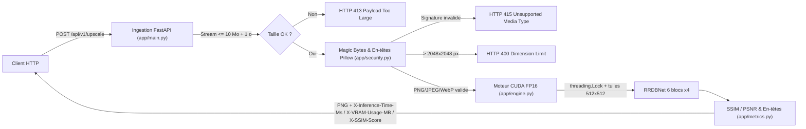

<div align="right">
  <a href="./README.md"></a>
  <a href="./README.fr.md"></a>
</div>

# Secure GPU Upscaler

Microservice d'inférence GPU durci exposant une super-résolution x4 (`Real-ESRGAN x4plus anime 6B`) derrière un sas anti-déni de service et un conteneur isolé.

## Contexte & Problème

Exposer un modèle de traitement d'image sur GPU via HTTP introduit deux risques directs dès que les fichiers proviennent de clients non fiables :

1. **Saturation RAM / VRAM** : des requêtes volumineuses, des extensions maquillées ou des *decompression bombs* peuvent faire tomber le worker FastAPI ou provoquer un `CUDA Out Of Memory` sur des GPU 8 Go.
2. **Surface d'attaque conteneur et désérialisation** : exécuter le service en `root` ou charger des poids PyTorch sans restriction expose à l'exécution de code arbitraire et à l'escalade de privilèges.

Ce projet borne la taille, le format réel, la résolution, l'empreinte VRAM et les ressources système avant et pendant l'inférence.

## Architecture Technique



## Choix d'Ingénierie, Sécurité & Performance

- **Ingestion streamée et sas anti-DoS (`app/security.py`)** : lecture incrémentale plafonnée à 10 Mo + 1 octet (rejet HTTP 413 avant mise en tampon complète), contrôle strict des magic bytes PNG/JPEG/WebP (HTTP 415) et lecture paresseuse des dimensions via Pillow pour bloquer tout dépassement de 2048x2048 px (HTTP 400).
- **Chargement sûr et inférence FP16 (`app/engine.py`)** : chargement des poids avec `torch.load(..., weights_only=True)`, exécution sous `torch.inference_mode()` en demi-précision FP16 et verrou `threading.Lock` pour sérialiser l'accès GPU.
- **Empreinte VRAM constante par tuilage** : découpage en tuiles de 512x512 px avec recouvrement `tile_pad=10` pour supprimer les coutures. Sur RTX 4060 Ti (8 Go) sous quotas Docker 4 Go RAM / 2.0 CPU, le pic VRAM reste stable autour de **559 à 562 Mo** de 256x256 (326.5 ms) jusqu'à 2048x2048 vers 8192x8192 (9520.0 ms).
- **Durcissement conteneur (`Dockerfile`, `docker-compose.yml`)** : exécution non-root `appuser` (`UID 10001`, `/usr/sbin/nologin`), `no-new-privileges:true`, quotas cgroups (`mem_limit: 4g`, `cpus: 2.0`), montage `./weights` en lecture seule (`:ro`), script `scripts/security_audit.sh` (Trivy + `docker inspect`) et CI automatisée sur le sas d'entrée.

## Démarrage Rapide

### Prérequis

- Docker avec NVIDIA Container Toolkit (ou Docker Desktop WSL2 avec support GPU)
- Poids placés dans `weights/RealESRGAN_x4plus_anime_6B.pth`

### Lancer le service

```bash
git clone https://github.com/Git-MohamedB/secure-gpu-upscaler.git
cd secure-gpu-upscaler

# Télécharger les poids du modèle
python scripts/download_weights.py

# Construire et démarrer le conteneur
docker compose up -d
```

### Vérifier l'état et tester l'API

```bash
curl -s http://localhost:8000/api/v1/health

curl -X POST "http://localhost:8000/api/v1/upscale" \
  -F "file=@sample.png" \
  --output "sample_x4.png" \
  -D -
```

### Tests et audit de sécurité

```bash
pytest tests/test_pipeline.py -v
bash scripts/security_audit.sh
```

## Pistes d'Amélioration

- Remplacer l'attente synchrone sur le verrou GPU par une file d'attente bornée renvoyant HTTP 503 en cas de pic de charge.
- Exposer un endpoint `/metrics` au format Prometheus en complément des en-têtes HTTP de télémétrie.
- Activer `read_only: true` avec `tmpfs` dédié et `cap_drop: ["ALL"]` dans `docker-compose.yml`.
- Ajouter un rate limiting par adresse IP côté proxy ou middleware.
