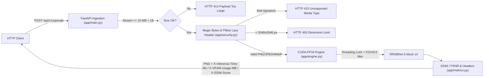

<div align="right">
  <a href="./README.md"></a>
  <a href="./README.fr.md"></a>
</div>

# Secure GPU Upscaler

Hardened GPU inference microservice exposing 4x super-resolution (`Real-ESRGAN x4plus anime 6B`) behind an anti-DoS ingestion gate and strict container isolation.

## Context & Problem

Serving deep-learning image models over HTTP exposes two immediate failure modes when inputs are untrusted:

1. **Host memory / GPU exhaustion**: oversized payloads, disguised binaries, or high-resolution compressed images (decompression bombs) can crash the API worker or trigger `CUDA Out Of Memory` on 8 GB class GPUs.
2. **Container & serialization attack surface**: running model servers as `root` or calling unrestricted `torch.load()` opens paths to privilege escalation and arbitrary code execution.

This service enforces size, format, dimension, VRAM, and Linux cgroup bounds before and during inference.

## Technical Architecture



## Engineering Choices, Security & Performance

- **Bounded streaming & DoS gate (`app/security.py`)**: Reads uploads incrementally up to 10 MB + 1 byte (rejects HTTP 413 without buffering large files), checks magic bytes for PNG/JPEG/WebP (HTTP 415), and parses dimensions lazily with Pillow before pixel decoding to reject > 2048x2048 inputs (HTTP 400).
- **Safe deserialization & FP16 inference (`app/engine.py`)**: Loads weights via `torch.load(..., weights_only=True)` under `torch.inference_mode()` in IEEE FP16, guarded by a `threading.Lock` mutex to serialize GPU access cleanly.
- **Constant VRAM footprint via spatial tiling**: Splits inputs into 512x512 tiles with `tile_pad=10` overlap to remove tile seam artifacts. Measured on an RTX 4060 Ti (8 GB) under a 4 GB RAM / 2.0 CPU Docker limit: peak VRAM stays flat around **559 to 562 MB** from 256x256 (326.5 ms) up to 2048x2048 -> 8192x8192 (9520.0 ms).
- **Container hardening (`Dockerfile`, `docker-compose.yml`)**: Runs as non-root `appuser` (`UID 10001`, `/usr/sbin/nologin`), applies `no-new-privileges:true`, enforces `mem_limit: 4g` and `cpus: 2.0`, and mounts `./weights` read-only (`:ro`). Includes `scripts/security_audit.sh` (Trivy + `docker inspect` checks) and automated CI checks on upload limits.

## Quick Start

### Prerequisites

- Docker with NVIDIA Container Toolkit (or Docker Desktop WSL2 GPU backend)
- Model weights placed at `weights/RealESRGAN_x4plus_anime_6B.pth`

### Run with Docker Compose

```bash
git clone https://github.com/Git-MohamedB/secure-gpu-upscaler.git
cd secure-gpu-upscaler

# Download model weights
python scripts/download_weights.py

# Build and start the hardened container
docker compose up -d
```

### Verify Health & Upscale an Image

```bash
curl -s http://localhost:8000/api/v1/health

curl -X POST "http://localhost:8000/api/v1/upscale" \
  -F "file=@sample.png" \
  --output "sample_x4.png" \
  -D -
```

### Run Tests & Security Audit

```bash
pytest tests/test_pipeline.py -v
bash scripts/security_audit.sh
```

## Future Improvements

- Add async request queuing (e.g., bounded worker queue with backpressure HTTP 503) instead of blocking a thread on the GPU mutex under burst traffic.
- Export Prometheus `/metrics` directly instead of relying solely on response telemetry headers.
- Enable read-only root filesystem (`read_only: true` with explicit `tmpfs`) and drop all Linux capabilities (`cap_drop: ["ALL"]`) in `docker-compose.yml`.
- Add rate limiting per client IP at the reverse-proxy or middleware layer.
